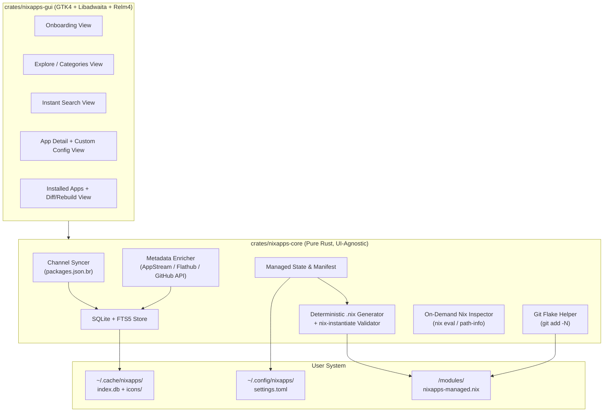

# Technical Architecture — NixApps

## 1. High-Level Overview

NixApps is structured as a **Rust Cargo Workspace** with a strict separation between the headless core engine (`nixapps-core`) and the native desktop interface (`nixapps-gui`).



---

## 2. Crate Boundaries

### `crates/nixapps-core`
- **Zero GTK/UI dependencies.** Must compile and pass unit tests in headless CI environments.
- Responsibilities:
  - Downloading and streaming Brotli-compressed `packages.json.br` from `https://channels.nixos.org/<channel>/packages.json.br` directly into SQLite (avoiding loading giant JSON trees into RAM).
  - Full-text search (`FTS5`) and category filtering.
  - Enriching packages with icons and categories via AppStream / Flathub APIs, plus on-demand cached GitHub REST API metadata (with TTL and optional PAT support).
  - Managing the declarative state model (installed packages, target mode, per-app custom Nix blocks).
  - Generating clean, formatted `.nix` files deterministically, validating them via `nix-instantiate --parse`, and performing atomic writes.
  - Detecting Git repos for Flake configs and staging untracked managed files (`git add -N`).

### `crates/nixapps-gui`
- Built with **GTK4**, **Libadwaita**, and **Relm4** (Elm-inspired MVU architecture for GTK4 in Rust).
- Communicates with `nixapps-core` asynchronously (background worker threads / Tokio runtime) so the UI thread never blocks during index sync, API fetches, or Nix evaluations.

---

## 3. Managed Module & State Strategy

To guarantee reliability and prevent parser fragility, NixApps uses a **Source-of-Truth + Deterministic Generator** model:

1. **Structured State File** (stored alongside the managed `.nix` file or in `~/.config/nixapps/` — e.g., `nixapps-state.json` committed alongside the dotfiles so it syncs across machines):
   ```json
   {
     "schema_version": 1,
     "target": "home-manager",
     "channel": "nixos-26.05",
     "apps": [
       {
         "attr": "obsidian",
         "mode": "package",
         "custom_nix": null
       },
       {
         "attr": "lutris",
         "mode": "custom",
         "custom_nix": "environment.systemPackages = [ (pkgs.lutris.override { extraPkgs = pkgs: [ pkgs.zenity ]; }) ];"
       }
     ]
   }
   ```
2. **Generated `.nix` Module** (`modules/nixapps-managed.nix`):
   - Always regenerated deterministically from the structured state.
   - Validated with `nix-instantiate --parse <temp-file>` before atomically replacing the target file.
   - Example output for **Home Manager**:
     ```nix
     # Managed by NixApps — edits made outside NixApps may be overwritten.
     { pkgs, lib, ... }:
     {
       home.packages = with pkgs; [
         obsidian
         qbittorrent
         spotify
       ];

       # --- Custom per-app configurations ---
     }
     ```
   - Example output for **NixOS System**:
     ```nix
     # Managed by NixApps — edits made outside NixApps may be overwritten.
     { pkgs, lib, ... }:
     {
       environment.systemPackages = with pkgs; [
         obsidian
         qbittorrent
         spotify
       ];

       # --- Custom per-app configurations ---
     }
     ```

---

## 4. Data & Metadata Pipeline (No Fragile Scraping)

1. **Primary Package Catalog:** `https://channels.nixos.org/<channel>/packages.json.br` (official NixOS Hydra build artifact).
2. **Icons & Desktop Categories:** Cross-referenced against AppStream metadata (`nixos-appstream-data` / Flathub public AppStream API) cached locally in `~/.cache/nixapps/`.
3. **Briefing Enrichment (On-Demand):** When the user opens a package page whose `homepage` points to GitHub, fetch `GET /repos/{owner}/{repo}` and (optionally) README excerpt, cached in SQLite with a 7-day TTL to respect anonymous rate limits (60 req/h).
4. **Dependencies (On-Demand):** Invokes local `nix` CLI (`nix eval` / `nix derivation show`) lazily when the user expands the Dependencies section.

---

## 5. Safety Guarantees

- **Atomic writes:** Write to `.nixapps-managed.nix.tmp` → validate syntax → `fs::rename`.
- **Backup on first touch:** Never overwrite a pre-existing `.nix` file unless it carries the NixApps managed header or the user explicitly confirms.
- **No elevated privileges by default:** File writes happen as the normal user (dotfiles in `$HOME`). Elevation via `pkexec` is only requested if the user explicitly triggers a system rebuild or manages `/etc/nixos`.
